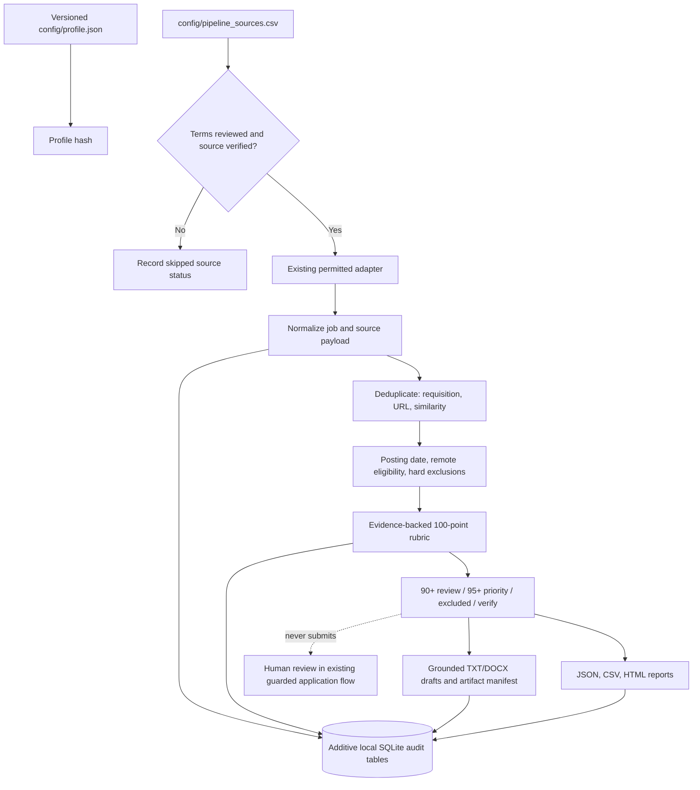

# Auditable job pipeline

The pipeline is additive to the existing discovery and application tools. Its command prepares
reports and local document drafts only; it has no path to submit an application.

## Run

```powershell
python -m app.cli run --config config/pipeline.yaml --since-hours 24 --min-score 90 --dry-run
```

Equivalent shorter command:

```powershell
python -m app.cli run
```

Options include `--max-sources`, `--max-jobs`, `--refresh-source SOURCE_NAME`,
`--priority-score`, `--concurrency`, and `--export DIRECTORY`. The defaults are loaded from
`config/pipeline.yaml`. The review floor cannot be set below 90 and the priority floor cannot be
set below 95; thresholds are never reduced to meet a quota.

Run an individual source check with:

```powershell
python -m app.cli source-test remoteok
python -m app.cli pipeline-health
python -m app.cli pipeline-tracker
```

Source checks require `terms_reviewed=true` and an enabled adapter. Review a candidate's terms
and access method before enabling it, then use `source-test`. A passing check requires at least
one record with a title and HTTPS application route; zero-result, malformed, partial, disabled,
and failed checks are reported separately. A source check does not update the registry or imply
legal approval. `manual_import` sources are listed for reference and are not scraped.
`pipeline-tracker` lists local application records. Updating a record to `APPLIED` requires an
explicit `--applied-at` date/time so the pipeline cannot invent an application marker.

## Source registry

`config/pipeline_sources.csv` contains 108 candidate sources. Eight entries are validated and
eligible for network checks: RemoteOK, ArbeitNow, Remotive, Jobicy, We Work Remotely's public RSS
feed, and the Greenhouse boards for GitLab, Elastic, and Canonical. Jobicy's public API documentation
expressly supports job-discovery products and requests attribution/linking to the original listing.
We Work Remotely's RSS endpoint is public, robots.txt allows it, and its terms grant limited-purpose
access; collection is limited to this local job-discovery workflow and source listings are not
republished. Live checks on 2026-10-29 returned 200 valid Jobicy records and 96 valid We Work
Remotely records. The remaining 100 rows remain `needs_review` and are not contacted by the
pipeline. Their presence is a registry entry, not verification that the site was checked, can be
scraped, or permits automated access. An eligible source is not proof that its individual jobs are
recent, remote from India, or suitable.
The company entries use existing homepage/career URLs; where only a homepage was available, the
notes explicitly require a human to confirm the actual career route. These are candidates, not
claims that a URL, source, API, or job is presently accessible.

Only sources that both have reviewed terms and are explicitly marked `verified` or `active` are
eligible during a normal run. `enabled=false` in either the registry or source configuration
blocks access even with `--refresh-source` or `source-test`. Other candidate URLs are not
contacted.

The web app's **Pipeline** page uses this same registry and database. Its run button triggers the
same dry-run pipeline command, and its result page shows the latest pipeline run rather than
legacy dashboard counts. The dashboard queue and old source-health history are still available
for backwards compatibility, but are labeled legacy data.

The **Ireland** and **Italy** tabs are views over the shared legacy application queue. Each also
lists 251 country-focused links from the supplied snapshots (20 priority employers, 30 job boards,
200 employer career pages, and one country-specific starting link). These are manual references,
not reviewed scraper sources or evidence of live vacancies. They remain excluded from automatic
scraping until access methods and terms are reviewed. A country tab's batch button uses the
existing application backend and limits each request to 50 jobs; the all-country Daily batch can
include eligible Ireland and Italy jobs already in the shared queue. The reviewed pipeline's own
assessment records are intentionally not promoted into the application queue or submitted.
Country and remote labels do not establish visa sponsorship, relocation eligibility, or permission
to work from India; verify these for each individual vacancy.

## Flow



## Data and safety

- Candidate facts come from the existing `config/profile.json`, versioned by SHA-256. No CV is
  present in `data/resumes` or `data/master`; the pipeline therefore uses profile facts only.
- Publication timestamps are accepted only from explicit publication-semantic fields such as
  `published_at`, `publication_date`, RemoteOK's `date`, `datePublished`, `releasedDate`, or `pubDate`.
  `created_at`, update timestamps, first-seen timestamps, and fetch time are not substituted.
  The original timestamp and its source field are retained alongside `fetched_at`.
- Eligibility is `india_confirmed`, `international_contractor_confirmed`, `unclear`,
  `country_restricted`, or `not_eligible`. A generic “remote” statement alone is unclear and
  cannot satisfy the fully-remote gate.
- Hard exclusions override scores. The rubric is visible in each assessment:
  documented skills (25), India/contract eligibility (20), seniority/qualification (15),
  compensation reliability (10), freshness/competition (10), career alignment (10),
  source/employer credibility (5), and schedule compatibility (5). Unsupported or missing
  evidence receives zero points and carries a reason code.
- The pipeline produces TXT and DOCX drafts only for high-tier jobs. Each candidate claim must match
  profile facts; the target role and employer are kept as application metadata. Artifacts include
  a profile hash, job ID, SHA-256, and employer-role-date filename. Files are stored under a
  profile-versioned folder and repeated runs do not duplicate artifact records. Drafts are not
  sent or submitted.
- Audit state is stored in additive `pipeline_*` tables in the existing SQLite database.
  `pipeline_jobs` preserves first/last-seen timestamps and posting provenance; the separate
  `pipeline_source_payloads` table retains raw adapter payloads per run. Existing `jobs` and
  `applications` tables are not altered.
- Adapter failures are isolated, retried at most twice after the initial attempt with bounded
  exponential delay, and logged by source and safe exception/status code (not URL query strings
  or secrets). Source health records last success/failure, job count, valid sample count, and
  error/status.
  Concurrency defaults to one request worker and is adjustable in the config; request starts
  are rate-limited.

## Latest live dry-run summary

This full pipeline run completed on 2026-10-29 local time. All eight reviewed adapters succeeded;
the remaining 100 registry entries were not contacted. Counts and run identifier change as
sources update:

```text
Job pipeline summary (dry run; no applications submitted):
sources_configured: 108
sources_selected: 8
sources_succeeded: 8
sources_partial: 0
sources_failed: 0
sources_skipped: 100
source_registry_status_counts: {'needs_review': 100, 'verified': 8}
source_failures: []
source_skipped_details: []
source_counts: {'arbeitnow': 300, 'Canonical Careers': 314, 'Elastic Careers': 408, 'GitLab Careers': 234, 'Jobicy': 200, 'remoteok': 99, 'remotive': 11, 'We Work Remotely': 96}
discovered: 1662
deduplicated: 377
stale: 188
ineligible: 733
unknown_eligibility: 464
qualified_by_tier: {'90_plus_review': 0, '95_plus_priority': 0, 'excluded': 1081, 'needs_verification': 204}
documents_generated: 0
errors: 0
dry_run: True
profile_version: [local profile fingerprint omitted]
run_id: 20261028T202904Z-5dbaecf2
document_errors: []
```

No job reached either review tier in that run (1,081 were excluded and 204 need verification), so
no documents were generated. This is an intentional no-quota result, not a pipeline failure.
The run writes JSON, CSV, XLSX (`Run Summary`, `Jobs`, `Sources` sheets), and HTML reports under
`data/exports`; reports include source
attribution, original listing URLs, application URLs, source IDs, publication provenance, and
fetch times. Source payloads, assessments, tracker state, and timestamps are recorded in the
local database. `pipeline-tracker --update-job ID --set-status APPLIED --applied-at ISO_DATE`
updates a candidate-confirmed application record; it does not submit anything.

## Known limitations

- The live-validated Greenhouse boards return an `updated_at` value, not a verified original
  publication timestamp. Those jobs are not treated as fresh solely because they were updated.
  ArbeitNow's `created_at` is likewise not used as a posting date. Remotive states its API feed
  is delayed by 24 hours, so it cannot establish a job is less than 24 hours old.
- RemoteOK's listing API exposes an original `date`; at the validation check it returned 99
  records but none within the configured 24-hour window. Its reports retain the source link and
  attribution.
- Jobicy's public API only returns jobs published during the preceding seven days; its public
  `url` points to the Jobicy listing, and source attribution/linking is retained. The API does not
  provide a direct employer application URL without an optional paid API key, which this project
  does not use.
- We Work Remotely is read through its public RSS feed, not its HTML catalog. Its terms provide a
  limited-purpose right to access and use materials; the adapter is restricted to local discovery,
  keeps the original posting URL, and does not republish listings.
- AcademicPositions returned HTTP 403 during a public-page fetch check and was not seeded; no
  access-control or login circumvention was attempted. Twelve tested Lever slugs returned 404;
  no Lever company source is marked verified.
- The pipeline does not crawl robots.txt or automatically interpret source terms. Human review
  and explicit activation are required; inaccessible or unsupported sites remain untested.
- Current scoring uses conservative text evidence, not a language model. Qualification
  extraction is heuristic and requires human review; no unsupported score is treated as a
  decision.
- No original candidate CV was found in `data/resumes` or `data/master`. Existing files in
  `data/applications` are generated per-job artifacts and are not treated as a source CV. Drafts
  use only the versioned factual profile. PDF export, screening-answer generation, and form
  submission are not part of this pipeline.
- There is no full HTML response cache. JSON payloads returned by the ATS/feed adapters are
  retained in the per-run assessment snapshot; adapters that return no raw payload cannot
  provide a full source-page snapshot.
- Applicant counts are retained only when an adapter payload explicitly exposes a parseable
  applicant-count field.
- Missing compensation amounts, unknown remote scope, unknown India eligibility, and missing
  original publication dates go to `needs_verification`; they are not silently promoted.
- No pipeline secret is required. The existing `.env.example` contains optional project-wide
  AI/search/browser settings; no real token was added.

## Validation report

- `python -m pytest -q`: **115 passed**.
- Live adapter checks on 2026-10-29: Jobicy **PASS** (200 records; 200 valid) and We Work Remotely
  **PASS** (96 records; 96 valid). These are source checks, not a full pipeline run or application
  submissions.
- Full live dry run on 2026-10-29: **8 sources succeeded, 0 partial, 0 failed; 100 unreviewed sources
  skipped; 1,662 discovered; 377 deduplicated; 0 jobs qualified for review; 0 documents generated;
  0 errors; no applications submitted.**
- The earlier repeatability check was completed before Jobicy and We Work Remotely were enabled.
  Fixture acceptance tests prove first-seen timestamps and artifact records remain idempotent on
  repeated runs.
- Registry validation: **108 unique rows**, required columns present, eight entries verified and
  100 held for review.
- `git diff --check`: **passed**; Git emitted only LF/CRLF normalization warnings.

## Rollback

Back up local data before changing application files:

```powershell
python scripts/backup.py
```

The pipeline adds tables and does not perform destructive migrations. To disable it, stop using
`run` and remove the pipeline branch from `app/cli.py`; the legacy commands remain independent.
Keep or archive the `pipeline_*` tables and `data/exports` artifacts for audit. Do not drop the
tables or delete outputs unless you have separately backed them up.
